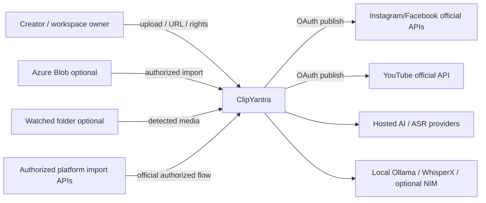
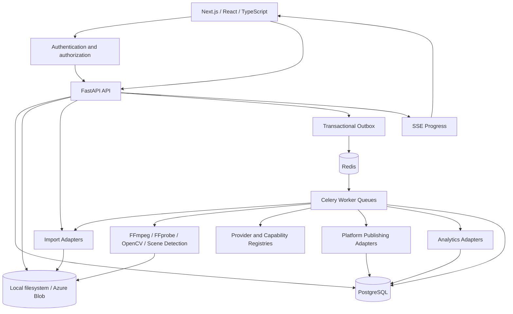
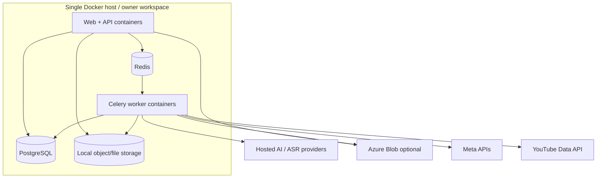
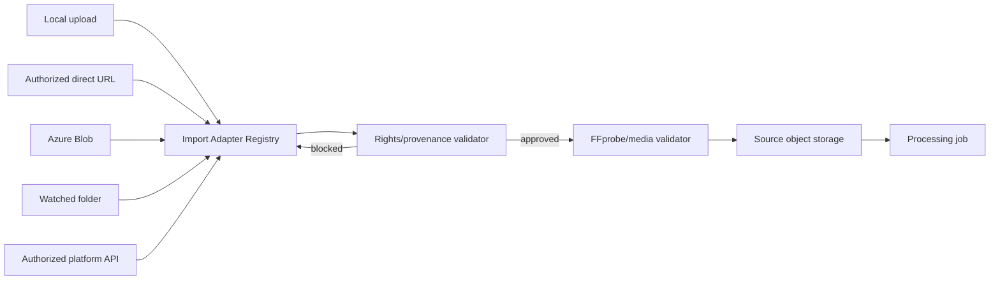
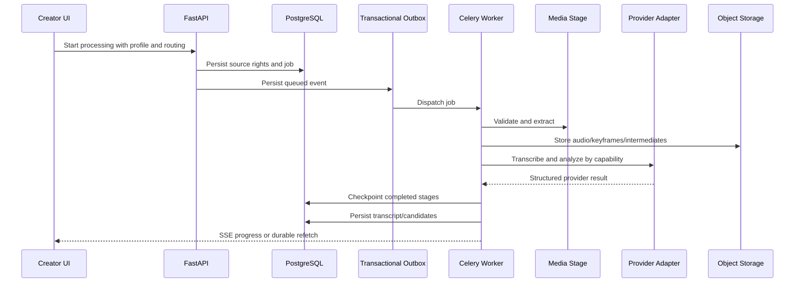
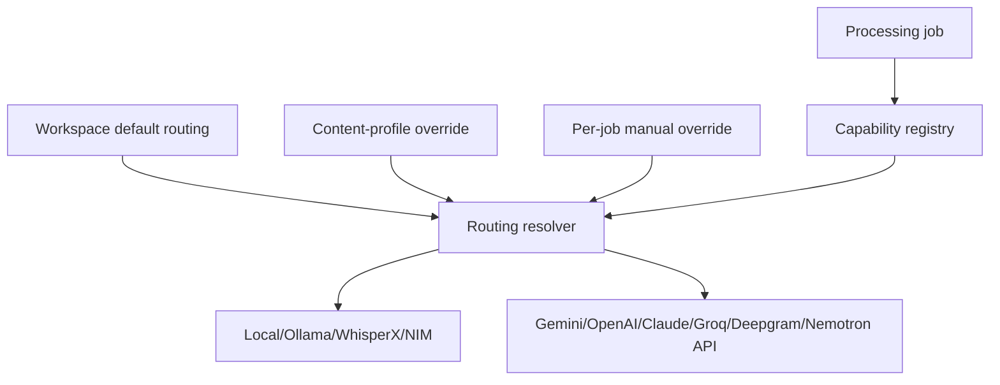
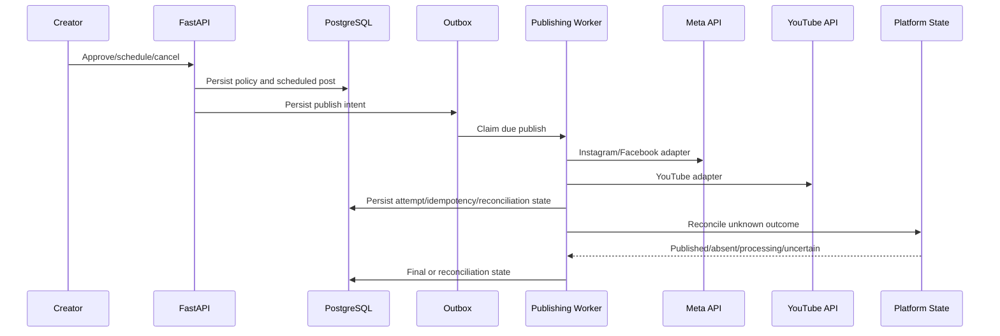

# Architecture - ClipYantra

**Status:** APPROVED v1 - Phase 08 architecture baseline  
**Version:** ARCH-1.1  
**Date:** 2026-11-23  
**Prerequisites:** Discovery, Requirements, UX, IA, Visual Direction, Wireframes and Design System approved/evidenced; Product Owner Decision v1 resolved  
**Approval:** `APPROVE ARCHITECTURE v1`

This document describes the proposed system architecture. It does not implement or freeze application contracts.

## 1. Architecture principles

1. Separate browser UI, API/domain logic, orchestration, AI providers, media processing and social integrations.
2. Use asynchronous stages and durable workflow state for all long-running work.
3. PostgreSQL is authoritative for workflow state and side-effect reconciliation.
4. Redis and Celery are execution infrastructure, not source-of-truth databases.
5. Every stage is restartable, observable and bounded.
6. Source media is immutable and retained outside relational database tables.
7. Edits create versioned drafts and typed reversible operations.
8. AI, storage and social platform integrations are replaceable adapters.
9. Publishing remains isolated from clipping and rendering and requires explicit authorization.
10. The MVP is self-hosted and single-workspace, but domain boundaries must remain SaaS-ready.

## 2. Product Owner Decision v1 constraints

### 2.1 Deployment

- Docker-based deployment.
- Initially one owner/workspace.
- Secure application authentication.
- No billing or subscription module in MVP.
- Keep workspace and brand boundaries available for future tenancy.
- Support local GPU processing and hosted/cloud AI providers.

### 2.2 Import connectors

Priority order:

1. Local uploads and direct authorized media URLs.
2. Azure Blob Storage and watched-folder ingestion.
3. Authorized platform integrations.

Implementation must not bypass DRM, login walls, access controls or platform download restrictions.

### 2.3 Publishing

MVP publishes through:

- Instagram Reels.
- Facebook Reels through Meta integration.
- YouTube Shorts.

Only official APIs, OAuth and capability validation are permitted.

### 2.4 Editing

- Desktop-first full multi-track editing.
- Tablet supports dashboard, preview, clip review, approve/reject, calendar and analytics.
- Tablet may use a limited editing view but does not promise full timeline precision.

### 2.5 Provider routing

Routing precedence:

1. Workspace default.
2. Content-profile override.
3. Per-job manual override.

Modes:

- Local-first.
- Balanced.
- Cloud-first.
- User-selected provider.

Per-brand routing is deferred.

## 3. System context

ClipYantra is a rights-gated processing and publishing workflow. It does not claim possession or permission from a URL and does not become an unofficial platform downloader.

## 4. Container architecture

## 5. Component responsibilities

| Component | Responsibility | Must not own |
|---|---|---|
| Frontend/BFF | Auth-bound requests, screen state, SSE rendering | Secrets or provider credentials |
| API | Validation, authorization, commands, query/read models | FFmpeg execution or long-running model work |
| Application services | Workflow rules, rights, approval, routing and side-effect intent | Direct SQL spread across routes |
| Repositories | PostgreSQL persistence and workspace scoping | External API and queue logic |
| Import adapters | Upload, URL, Azure, watched folder and authorized platform inputs | DRM bypass or rights inference |
| Processing workers | Stage execution and checkpoints | Browser or route state |
| Media workers | FFprobe, FFmpeg, OpenCV and scene/event processing | Publishing decisions |
| Provider registry | Provider selection and capability verification | Unverified provider assumptions |
| Publishing adapters | OAuth, platform-specific mapping, idempotency and reconciliation | Clip editing or rights declaration |
| Outbox | Atomic intent for asynchronous/external side effects | Directly storing media blobs |
| PostgreSQL | Durable workflow state, jobs, drafts, attempts and audit | Temporary processing files |
| Object storage | Original, intermediate and derived media | Workflow source-of-truth state |

## 6. Runtime and deployment topology

MVP deployment is Docker-based and may run on a development PC or a compatible self-hosted Linux host. Heavy workers are isolated from API processes. Resource limits are required for PostgreSQL, Redis, worker concurrency, media temp space and memory.

## 7. Import architecture

Import priority and adapter contract:

- `LocalUploadAdapter` and `AuthorizedUrlAdapter` are MVP first.
- `AzureBlobAdapter` and `WatchedFolderAdapter` follow after core upload/recovery.
- `AuthorizedPlatformAdapter` supports only official/authorized flows and may be provider-specific.
- No adapter attempts to bypass a platform restriction or private token.
- Each source record stores source type, rights state, provenance and original storage reference.

## 8. Processing pipeline

Stages:

1. validate source and rights;
2. extract technical metadata and normalized audio;
3. transcribe;
4. align/diarize if configured;
5. detect scenes/events and sample frames;
6. discover and rank candidates;
7. validate candidate boundaries/context;
8. render and validate output;
9. user review/approval;
10. schedule/publish/reconcile.

Each stage persists output and a completed checkpoint. Re-running a job does not delete prior stage evidence.

## 9. Provider registry and routing

Provider registry responsibilities:

- provider adapter and deployment mode;
- endpoint/config/credential reference;
- enabled/disabled and health state;
- verified model IDs and documentation;
- capabilities, languages, modalities and limits.

Capability registry responsibilities:

- task modality such as ASR, text reasoning, vision, video or structured JSON;
- language and timestamp support;
- output schema compatibility;
- cost unit and provider limits.

Routing resolution:

1. Start with workspace default.
2. Apply content-profile override.
3. Apply per-job manual override.
4. Filter providers by capability and enabled state.
5. Apply routing mode and cost limits.
6. Record resolved provider/model/prompt version and fallback.

Per-brand routing is not implemented in MVP.

Providers represented in architecture:

- NVIDIA Nemotron API Catalog.
- NVIDIA NIM.
- Gemini.
- OpenAI.
- Anthropic/Claude.
- Groq.
- Deepgram.
- Ollama.
- WhisperX/faster-whisper.

NVIDIA API Catalog and NVIDIA NIM are separate deployment/adaptor types. The architecture must not infer local GPU support from a provider name.

## 10. Clip Studio architecture

The UI and API preserve:

- immutable source media;
- immutable AI candidate;
- versioned draft and operation graph;
- sidecar/source map for captions, B-roll, effects and overlays;
- deterministic undo/redo;
- numeric and keyboard alternatives to drag operations;
- technical validation before publish eligibility.

AI edit operations are Pydantic-validated typed operations. The model cannot emit shell, Python or raw FFmpeg instructions.

## 11. Publishing architecture

Publishing workers use:

- official OAuth and least-privilege scopes;
- separate Meta and YouTube adapters;
- request hash and idempotency key;
- platform-specific capability profiles;
- transactional outbox;
- transactional claim/lease;
- reconciliation before duplicate retry;
- audit event trail.

Automatic publishing requires explicit opt-in and policy predicates. Human approval is the default.

## 12. Storage and data boundaries

- PostgreSQL stores workflow state, metadata and references.
- Object/file storage stores source, audio, frames, thumbnails, intermediate media and final clips.
- Azure Blob is optional and behind a storage-provider abstraction.
- Watched folders produce import events but remain monitored, not database blobs.
- Temporary work directories are isolated and cleaned according to retention policy.
- Secrets are server-side and referenced through encrypted secret storage or environment configuration.

## 13. Resilience and failure boundaries

| Boundary | Required behavior |
|---|---|
| Upload interrupted | Resume or retry without corrupting original |
| Worker crash | Lease expiry and durable stage checkpoint |
| Provider failure | Retry bounded, fallback by policy, preserve completed stages |
| Optional B-roll failure | Warning and fail-soft behavior where permitted |
| Render failure | No publish eligibility, preserve draft and diagnostics |
| Unknown publish result | Reconcile before retry, no blind duplicate |
| Storage failure | Block affected stage and preserve source metadata |
| OAuth expiry | Reconnect state, no token sent to browser/log |

External side effects use idempotency and reconciliation. Internal stages use checkpoints and leases.

## 14. Realtime progress

SSE is the proposed browser progress mechanism because it matches server-to-browser stage updates without adding bidirectional complexity. Clients must also support durable status refetch/reconnect.

Progress events include:

- event ID;
- job and source ID;
- stage;
- measured progress if available;
- safe message code;
- timestamp.

Raw transcripts, provider payloads and secrets are not sent in generic progress events.

## 15. Security and authorization

- secure application authentication for the owner/MVP workspace;
- server-side sessions or equivalent secure auth;
- workspace/resource authorization checks;
- least-privilege OAuth scopes;
- encrypted token storage or secret references;
- SSRF and redirect protection for URL imports;
- private storage credentials only in server configuration;
- audit for rights, approval, settings and publishing;
- no secrets in browser, logs or telemetry.

Future SaaS tenancy requires:

- workspace membership and role boundaries;
- workspace-scoped repository queries;
- provider credential isolation;
- brand and destination isolation;
- no shared mutable tenant data assumptions.

## 16. Observability

Record:

- correlation ID;
- workspace/source/job/clip IDs;
- stage;
- provider/model/prompt version;
- timings, retries and usage;
- worker/resource metrics;
- publish attempt and reconciliation state;
- error category and safe diagnostic.

Never log credentials, OAuth tokens or unnecessary private transcript/media content.

## 17. ADR summary

| ADR | Proposed decision | Status |
|---|---|---|
| ADR-001 | Self-hosted Docker MVP with one owner/workspace and SaaS-ready boundaries | PROPOSED |
| ADR-002 | PostgreSQL durable state; Redis/Celery execution infrastructure | PROPOSED |
| ADR-003 | StorageProvider abstraction for local filesystem and Azure Blob | PROPOSED |
| ADR-004 | ImportAdapter registry with rights gate and prioritized connector rollout | PROPOSED |
| ADR-005 | Hierarchical provider routing with capability registry | PROPOSED |
| ADR-006 | SSE for browser progress plus durable status refetch | PROPOSED |
| ADR-007 | Immutable sources/candidates and versioned draft operation graphs | PROPOSED |
| ADR-008 | Separate official Meta and YouTube publishing adapters | PROPOSED |
| ADR-009 | Desktop-first full timeline; tablet review/approval without timeline promise | PROPOSED |
| ADR-010 | Outbox, idempotency and reconciliation for external side effects | PROPOSED |

Detailed consequences and alternatives remain in the engineering decision and contract records until owner approval.

## 18. Open architecture decisions

- OUT-004: live-stream monitor architecture is deferred.
- OUT-005: AI dubbing/generated B-roll architecture remains fail-soft and post-MVP.
- Exact official provider model IDs and limits require implementation-time verification.
- Platform app review and account eligibility require test-account validation.
- Azure storage identity/credential model requires deployment configuration decision.
- Watched-folder authority and allowed path policy require host configuration.
- Local GPU/NIM deployment remains hardware-dependent.

## 19. Architecture approval checklist

- [ ] Self-hosted Docker MVP and SaaS-ready boundaries are explicit.
- [ ] All four import sources and priority order are represented.
- [ ] Meta and YouTube use separate official publishing adapters.
- [ ] Hierarchical provider routing is represented.
- [ ] NVIDIA API Catalog and NIM remain separate.
- [ ] PostgreSQL, Redis/Celery and storage boundaries are clear.
- [ ] Restartability, reconciliation and idempotency are explicit.
- [ ] Tablet editing limits are explicit.
- [ ] Risks and unresolved decisions are linked.
- [ ] No ADR is treated as approved by this draft.

## 20. Gate status

**Current status:** APPROVED v1 - `APPROVE ARCHITECTURE v1` received.  
**Next gate:** Full design approval (`APPROVE DESIGN v1`) after the remaining artifact audit.
