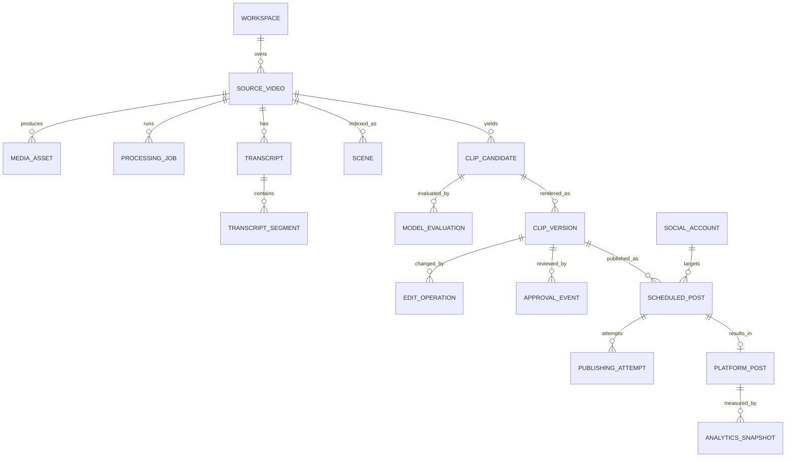

# Data Model — ClipYantra

**Status:** FROZEN v1 - Phase 10; approved by `APPROVE CONTRACTS v1`  
**ORM proposal:** SQLAlchemy 2.x + Alembic

## 1. Modelling rules

- UUID primary keys for application entities.
- UTC timestamps in storage.
- Workspace ownership on all tenant-owned entities.
- Store media object keys/URIs, not binary media in PostgreSQL.
- Store provider raw response references selectively; redact secrets and unnecessary personal data.
- Use optimistic version numbers for editable drafts.
- Preserve provenance from source → transcript → candidate → rendered version → scheduled/published post.

## 2. Core entities

| Entity | Main fields / responsibility |
|---|---|
| `users` | identity, status, created_at |
| `workspaces` | name, timezone, owner_id, settings |
| `workspace_members` | workspace_id, user_id, role |
| `brand_profiles` | logos, colors, fonts, caption preset, CTA defaults |
| `provider_configs` | provider, deployment mode, encrypted secret reference, enabled flag |
| `provider_models` | model ID, capabilities, languages, verified_at, docs URL |
| `provider_routing_policies` | workspace/profile/job scope, routing mode, provider priority, fallback and cost limits |
| `routing_resolutions` | job/task, resolved provider/model, precedence level, fallback history and verification time |
| `import_sources` | source type, adapter, external URI/path/account reference, rights state and configuration |
| `watched_folder_configs` | host/path glob or allowed location, workspace, lease state and dedupe key |
| `source_videos` | source type, rights state, duration, resolution, storage key, checksum |
| `source_rights` | declaration, rights basis, user, timestamp, restrictions |
| `media_assets` | source/derived asset type, storage key, mime, size, checksum |
| `processing_jobs` | job kind, status, priority, attempts, lease, progress, error |
| `transcripts` | language, provider/model, full text, status, version |
| `transcript_segments` | start/end ms, text, speaker, confidence, word alignment |
| `speakers` | source-scoped speaker IDs, optional face track mapping |
| `scenes` | start/end ms, keyframe asset, scene labels |
| `event_signals` | timestamp, signal type, value, provenance |
| `clip_candidates` | start/end ms, profile, editorial scores, status, explanation |
| `model_evaluations` | provider/model, candidate, rubric, scores, output reference |
| `clip_versions` | parent candidate/version, edit graph, render asset, state |
| `edit_operations` | allow-listed op, parameters, before/after references, actor, undo link |
| `source_maps` | source-timeline mapping for captions/B-roll/effects/overlays |
| `approval_events` | actor, decision, policy, timestamp, reason |
| `social_accounts` | platform, account IDs, scopes, status |
| `oauth_credentials` | encrypted token references and expiry; no plaintext token column |
| `publishing_policies` | account/category mode, limits, thresholds, schedule rules |
| `scheduled_posts` | clip_version, platform/account, metadata, due_at, state |
| `publishing_attempts` | idempotency key, request hash, response ref, state, retries |
| `platform_posts` | external post ID, permalink, published_at |
| `analytics_snapshots` | metric name/value/period/captured_at/source |
| `usage_ledger` | provider/model, units, estimated/actual cost, job link |
| `audit_logs` | security- and business-significant actions |
| `outbox_events` | event type, aggregate, payload, dispatch state |

## 3. Relationships

## 4. State machines

### Processing job

Canonical states:

`created → queued → running → waiting_for_input | retrying | succeeded | failed | cancelled`

Only registered transitions may mutate state. Stage checkpoints are stored separately and do not redefine the job state.

### Candidate

Canonical states:

`discovered → validated → ranked → pending_review | needs_edit | accepted | rejected | duplicate`

### Clip version

Canonical states:

`editing → saving → saved | save_failed | conflict`

Render state is separate:

`queued → rendering → validating → ready | failed`

### Scheduled post

Canonical states:

`draft → awaiting_approval → scheduled → claimed → uploading → processing_on_platform → published`

Failure/recovery states:

`retry_wait | unknown_outcome | failed | cancelled | needs_reconnect | rejected`

Unknown outcome requires reconciliation before any retry.

## 4.1 Migration order

Initial migration sequence:

1. users and workspaces.
2. workspace members, brands and audit logs.
3. provider configurations, provider models and routing policies.
4. import sources and watched-folder configurations.
5. source videos, rights and media assets.
6. processing jobs, outbox events and stage checkpoints.
7. transcripts, segments, speakers, scenes and event signals.
8. candidates, model evaluations and source maps.
9. clip versions, edit operations and approval events.
10. social accounts, OAuth credential references and publishing policies.
11. scheduled posts, publishing attempts and platform posts.
12. analytics snapshots and usage ledger.

Every migration is reviewed for:

- reversible upgrade/downgrade behavior where feasible;
- workspace-index coverage;
- no destructive deletion of source media;
- no plaintext OAuth secrets;
- unique publish and checksum constraints;
- state-transition/backfill policy;
- explicit seed data and fixture policy.

## 5. Important indexes and constraints

- Unique source checksum per workspace where appropriate.
- Index source IDs and status/time columns used by queues.
- Index due posts on `(status, scheduled_at)`.
- Unique idempotency key for each logical platform publish operation.
- Prevent two active attempts for the same scheduled post.
- Enforce `end_ms > start_ms` and source-duration bounds.
- Enforce workspace scoping in repository queries.
- Use JSONB only for variable metadata/edit graphs, not as a substitute for relational integrity.

## 6. Data retention

Define configurable retention separately for originals, intermediates, generated clips, transcripts, event signals, logs and analytics. Never delete source assets merely because a derived render is regenerated. Retention/deletion must be auditable and documented before implementation.
