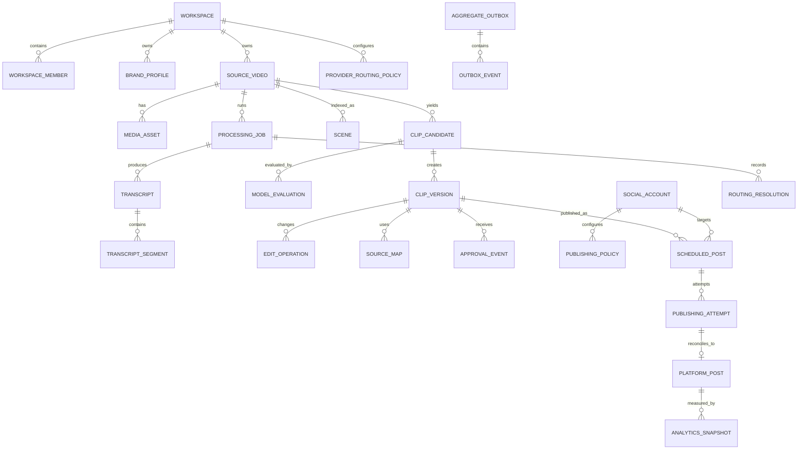

# Contract Freeze Baseline

**Status:** APPROVED v1 - Contract Freeze  
**Version:** CONTRACT-1.0-DRAFT  
**Date:** 2026-11-23  
**Prerequisites:** `APPROVE DESIGN v1`, `APPROVE ARCHITECTURE v1`
**Approval:** `APPROVE CONTRACTS v1`

This document is the frozen cross-layer contract baseline. It does not implement Pydantic models, database migrations, API routes or workers.

## 1. Freeze scope

This freeze covers:

- entity relationships and migration order;
- Pydantic request/response names and field categories;
- API route naming, pagination and error contract;
- processing, job, SSE, clip, draft, render and publishing state machines;
- edit-operation allow-list;
- source-map format;
- storage key layout;
- provider-routing resolution record;
- idempotency, outbox and lease semantics;
- publish reconciliation;
- contract-test categories.

It does not freeze provider model IDs, exact platform limits or numeric quality thresholds until official documentation and benchmarks verify them.

## 2. Cross-layer invariants

1. UUID primary keys are JSON strings.
2. API timestamps are ISO-8601 UTC strings.
3. PostgreSQL timestamps are UTC.
4. Source-relative time uses `*_ms` fields and is explicitly named source-relative.
5. Clip-relative time uses `*_clip_ms` or equivalent namespaced fields.
6. Unknown provider/platform/platform-state values are represented explicitly, never guessed.
7. No API exposes secrets, OAuth tokens or raw private provider payloads.
8. Workspace and resource authorization is checked on every resource operation.
9. Source media and immutable candidates are not mutated by edit operations.
10. External side effects use idempotency and reconciliation.
11. Job stages use checkpoints and leases.
12. Contract examples are non-implementation fixtures and must match Pydantic/OpenAPI schemas.

## 3. Entity relationship freeze

Authoritative relationships:



Required uniqueness and constraints:

- workspace membership is unique per `(workspace_id, user_id)`;
- source checksum deduplication is scoped to workspace unless the product owner approves global dedupe;
- a source video has one current rights record or a rights event history;
- provider routing resolution is scoped to workspace/profile/job;
- clip edit operation order is deterministic and versioned;
- source maps reference a valid source and clip version;
- publish idempotency key is unique for a logical render/platform/account/policy operation;
- a scheduled post may have at most one active claimed/uploading attempt;
- publishing attempts retain a request hash and response reference;
- audit events are append-only.

## 4. Migration freeze

Migration order:

1. users and workspaces;
2. workspace members, brands and audit tables;
3. provider configurations/models/routing policies;
4. import sources and watched-folder configurations;
5. source videos, rights and media assets;
6. processing jobs, stage checkpoints and outbox;
7. transcripts, segments, speakers, scenes and event signals;
8. candidates, model evaluations and source maps;
9. clip versions, edit operations and approval events;
10. social accounts, OAuth credential references and publishing policies;
11. scheduled posts, publishing attempts and platform posts;
12. analytics snapshots and usage ledger.

Alembic migration rules:

- initial migration creates the frozen core;
- each later migration includes upgrade and downgrade intent or an explicit irreversible-marking policy;
- migrations do not move or delete source media;
- state backfills use a documented compatibility transition;
- OAuth secrets use secret-reference fields, never plaintext token columns;
- JSON is limited to variable metadata/edit graph fields and never replaces relational integrity;
- migration tests cover clean install, upgrade and workspace-scoped uniqueness.

## 5. Pydantic schema freeze

Use Pydantic models at API boundaries. Names are freeze candidates:

- `SourceCreateRequest`
- `SourceCreateResponse`
- `ProcessingJobCreateRequest`
- `ProcessingJobResponse`
- `StageStatusResponse`
- `TranscriptResponse`
- `CandidateResponse`
- `CandidateListResponse`
- `DraftUpdateRequest`
- `DraftResponse`
- `EditOperationRequest`
- `EditOperationResponse`
- `RenderCreateRequest`
- `RenderResponse`
- `ApprovalRequest`
- `ApprovalResponse`
- `PublishPostRequest`
- `PublishPostResponse`
- `ProviderRoutingPolicyRequest`
- `ProviderRoutingPolicyResponse`
- `ErrorResponse`
- `SseEventEnvelope`

### 5.1 Source creation request

```json
{
  "source_type": "local_upload",
  "title": "string",
  "rights_declaration": "owned",
  "rights_note": "optional string",
  "storage_reference": "string",
  "content_profile": "podcast_interview",
  "routing_override": null
}
```

Allowed source types for the MVP:

- `local_upload`
- `authorized_url`
- `azure_blob`
- `watched_folder`
- `authorized_platform`

Rights values:

- `owned`
- `authorized`
- `public_domain`
- `unknown_blocked`

Unknown rights block processing.

### 5.2 Processing job request

```json
{
  "source_video_id": "uuid",
  "content_profile": "podcast_interview",
  "language_policy": "auto",
  "duration_policy": {
    "min_seconds": null,
    "max_seconds": null
  },
  "routing_override": null,
  "output_presets": ["vertical_9_16"]
}
```

Exact duration limits are configuration values, not frozen numeric defaults. The contract freezes field existence and type only.

### 5.3 Processing job response

```json
{
  "job_id": "uuid",
  "source_video_id": "uuid",
  "status": "queued",
  "progress_percent": null,
  "current_stage": "validate",
  "started_at": "2026-11-23T12:00:00Z",
  "completed_at": null,
  "error": null,
  "status_url": "/api/v1/jobs/uuid",
  "events_url": "/api/v1/jobs/uuid/events"
}
```

`progress_percent` is `null` unless a stage provides measured progress.

### 5.4 Candidate response

```json
{
  "candidate_id": "uuid",
  "source_video_id": "uuid",
  "start_source_ms": 42000,
  "end_source_ms": 75000,
  "category": "hook",
  "status": "pending_review",
  "score_breakdown": {
    "standalone": null,
    "context": null,
    "payoff": null
  },
  "rationale": "string",
  "transcript_excerpt": "string",
  "provider_evaluations": []
}
```

Score fields are evidence values or `null`; no response must imply a guaranteed virality probability.

### 5.5 Edit operation request

```json
{
  "draft_id": "uuid",
  "base_version": 3,
  "operation_id": "uuid",
  "operation_type": "TrimRange",
  "parameters": {
    "start_source_ms": 42000,
    "end_source_ms": 75000
  },
  "request_source": "user",
  "preview_only": true
}
```

The `operation_type` enum is frozen below. Unknown operation types fail validation.

### 5.6 Publish post request

```json
{
  "render_id": "uuid",
  "social_account_id": "uuid",
  "platform": "youtube",
  "metadata": {
    "title": "string",
    "caption": "string",
    "hashtags": [],
    "cta": null
  },
  "publish_mode": "scheduled",
  "scheduled_at": "2026-11-23T13:30:00Z",
  "policy_id": "uuid"
}
```

Platform and publish-mode enums are validated by Pydantic and by platform capability profiles.

### 5.7 Error response

```json
{
  "code": "VALIDATION_FAILED",
  "message": "One or more fields are invalid.",
  "details": {
    "field_errors": []
  },
  "request_id": "uuid"
}
```

## 6. API and pagination contract

- base prefix: `/api/v1`;
- JSON request/response content;
- UUID IDs;
- ISO-8601 UTC timestamps;
- collection responses use `items`, `total`, `next_cursor`;
- long-running operations use `202` plus `status_url`;
- SSE endpoints use `GET`;
- mutations use explicit POST/PATCH/DELETE semantics;
- workspace and resource authorization is required;
- unknown enum values return a contract validation error;
- no endpoint returns OAuth credentials or provider secrets.

Long-running routes include source imports, processing, render and publish actions.

## 7. SSE event contract

Event envelope:

```json
{
  "event_id": "uuid",
  "job_id": "uuid",
  "source_video_id": "uuid",
  "stage": "transcribe",
  "status": "running",
  "progress_percent": null,
  "message_code": "TRANSCRIPTION_RUNNING",
  "timestamp": "2026-11-23T12:05:00Z"
}
```

Event names:

- `job.started`
- `stage.started`
- `stage.progress`
- `stage.completed`
- `job.warning`
- `job.failed`
- `job.completed`

SSE invariants:

- event IDs are monotonic enough for deduplication;
- reconnect uses `Last-Event-ID` or a durable status refetch;
- progress is measured or null;
- private transcripts, raw provider payloads and secrets are never sent;
- terminal event is followed by durable final state.

## 8. Processing state contract

Source:

`created -> uploading -> validating -> ready | rejected | failed`

`ready -> archived`

Job:

`created -> queued -> running -> waiting_for_input | retrying | succeeded | failed | cancelled`

Stage checkpoint states:

`pending -> running -> succeeded | failed | skipped`

Candidate:

`discovered -> validated -> ranked -> pending_review | needs_edit | accepted | rejected | duplicate`

Only registered transitions may occur. State transition history is recorded.

## 9. Clip and draft state contract

Draft:

`editing -> saving -> saved | save_failed | conflict`

`saved -> editing`

Render:

`queued -> rendering -> validating -> ready | failed`

Approval:

`pending -> approved | rejected`

No render with `failed` or `validating` may enter publish eligibility.

## 10. Allowed edit operation contract

The MVP allow-list is:

- `TrimRange`
- `SplitAt`
- `MergeClips`
- `SetAspectRatio`
- `SetCropMode`
- `SetCropKeyframes`
- `UpdateCaptionText`
- `ShiftCaptionCue`
- `SetCaptionStyle`
- `AddBrollCue`
- `MoveBrollCue`
- `RemoveBrollCue`
- `AdjustAudioGain`
- `AddEffect`
- `RemoveEffect`
- `SetBrandOverlay`

Rules:

- server validates operation type, source/clip bounds and permissions;
- operations cannot emit raw FFmpeg filters or executable code;
- preview operations do not mutate the draft;
- apply operations create a new immutable operation record and version;
- undo/redo restores deterministic prior state;
- source maps are updated transactionally with the operation.

## 11. Source-map contract

Canonical source-map format:

```json
{
  "source_map_version": "1",
  "source_video_id": "uuid",
  "candidate_id": "uuid",
  "draft_id": "uuid",
  "clip_version_id": "uuid",
  "time_unit": "milliseconds",
  "segments": [
    {
      "segment_id": "uuid",
      "segment_type": "caption",
      "source_start_ms": 42000,
      "source_end_ms": 75000,
      "clip_start_ms": 0,
      "clip_end_ms": 33000,
      "asset_id": null,
      "properties": {}
    }
  ]
}
```

Segment types include:

- `video`
- `audio`
- `caption`
- `broll`
- `effect`
- `overlay`
- `brand`

Source-map rules:

- source and clip time ranges use the declared units;
- source ranges may not exceed source duration;
- clip ranges may not overlap invalidly;
- every edit updates the relevant segment mapping;
- source map is versioned with the clip draft;
- invalid source maps block render/QA.

## 12. Storage key freeze

Object keys are workspace-scoped:

```text
workspaces/{workspace_id}/sources/{source_id}/original/{basename_or_hash}
workspaces/{workspace_id}/sources/{source_id}/audio/{asset_id}.wav
workspaces/{workspace_id}/sources/{source_id}/proxies/{asset_id}.mp4
workspaces/{workspace_id}/sources/{source_id}/frames/{asset_id}.jpg
workspaces/{workspace_id}/sources/{source_id}/transcripts/{transcript_id}.json
workspaces/{workspace_id}/candidates/{candidate_id}/thumbnail/{asset_id}.jpg
workspaces/{workspace_id}/drafts/{draft_id}/source-map/{version}.json
workspaces/{workspace_id}/renders/{render_id}/clip.{container}
workspaces/{workspace_id}/renders/{render_id}/qa.json
workspaces/{workspace_id}/brand/{brand_profile_id}/{asset_id}.{ext}
```

Rules:

- original source keys are immutable;
- render keys include immutable render ID;
- keys include checksum or immutable ID where overwrite risk exists;
- database stores keys/reference, not bytes;
- private storage is default;
- temporary scratch paths are never persisted as canonical media paths.

## 13. Publishing state contract

Canonical publish states:

`draft -> awaiting_approval -> scheduled -> claimed -> uploading -> platform_processing -> published`

Recovery/terminal states:

`retry_wait | unknown_outcome | failed | cancelled | needs_reconnect | rejected`

Platform values:

- `youtube`
- `instagram`
- `facebook`

Publish modes:

- `manual`
- `scheduled`
- `automatic`
- `hybrid`

Policy predicates are evaluated server-side and recorded with the approval/publish attempt.

## 14. Idempotency contract

| Side effect | Key pattern | Reconciliation |
|---|---|---|
| Upload/session import | workspace + checksum/source URI hash + rights context | Resume or reuse existing source |
| Processing job | source + profile + routing resolution + config version | Return existing active job or create new versioned job |
| Render | draft version + render spec hash + platform-independent preset | Reuse or create distinct immutable render |
| Edit apply | operation ID + base draft version | Reject duplicate active operation |
| Publish | render ID + social account ID + platform + policy/version | Persist attempt and reconcile before retry |
| Reconciliation | attempt ID + platform query cursor/operation ID | Store final or uncertain state |

No publish retry repeats a blind call after timeout. Unknown outcome first reconciles platform state.

## 15. Outbox contract

Outbox event fields:

- `event_id`
- `aggregate_type`
- `aggregate_id`
- `event_type`
- `payload`
- `status`
- `attempt_count`
- `next_attempt_at`
- `last_error`
- `created_at`
- `published_at`

Status values:

`pending -> claimed -> published | failed | dead_letter`

Payload rules:

- reference IDs and safe job metadata only;
- no OAuth tokens or private media content;
- payload must be redacted and schema-versioned;
- external side-effect workers acknowledge and reconcile.

## 16. Lease contract

Processing and publishing workers use leases:

```json
{
  "lease_owner": "worker-uuid",
  "lease_until": "2026-11-23T12:10:00Z",
  "attempt_count": 1
}
```

Lease rules:

- lease expiry requeues or restarts only from an idempotent stage;
- worker cancellation is persisted and checked between stages;
- publishing claims prevent two active upload attempts;
- stale claims enter reconciliation or retry state.

## 17. Provider routing contract

Routing resolution fields:

- workspace default;
- content-profile override;
- per-job override;
- routing mode;
- capability task;
- provider/model candidate list;
- selected provider/model;
- fallback provider/model list;
- cost limit;
- verification time;
- audit/version reference.

Routing order is frozen:

1. workspace default;
2. profile override;
3. per-job override;
4. capability filter;
5. cost/availability filter;
6. provider/model selection.

Per-brand routing remains deferred.

Provider names and deployment types:

- NVIDIA API Catalog;
- NVIDIA NIM;
- Gemini;
- OpenAI;
- Anthropic/Claude;
- Groq;
- Deepgram;
- Ollama;
- WhisperX/faster-whisper.

Official model IDs are not frozen here; capability metadata is verified at implementation time.

## 18. Contract test plan

### 18.1 Pydantic and OpenAPI

- positive and negative examples for every request/response;
- unknown field strictness test;
- enum boundary test;
- timestamp and UUID format test;
- source/clip millisecond unit test;
- no-secret response test.

### 18.2 Entity and migration

- clean migration test;
- upgrade and rollback/irreversible policy test;
- workspace uniqueness and isolation;
- publish idempotency constraint;
- source and clip range constraints;
- source-media key immutability.

### 18.3 API and SSE

- route authorization;
- pagination and cursor behavior;
- error code stability;
- 202/status/events behavior;
- SSE reconnect and event ordering;
- terminal event and durable refetch consistency.

### 18.4 State machine

- valid transition matrix;
- illegal transition rejection;
- candidate/draft/render/publish failure paths;
- unknown publish outcome reconciliation;
- retry from last completed stage;
- lease expiry and stale claim.

### 18.5 Side effects

- duplicate upload, job and render handling;
- publish idempotency test;
- outbox retry and dead-letter test;
- reconcile unknown outcome;
- secret redaction;
- bounded provider fallback.

### 18.6 Source map and render

- source and clip range validation;
- trim/split/merge mapping;
- caption/B-roll/overlay mapping;
- invalid source map blocks QA/render;
- source map version mismatch;
- output technical validation.

## 19. Contract freeze conflicts to resolve

Before `APPROVE CONTRACTS v1`, resolve or explicitly defer:

- exact supported source formats, size and duration limits;
- exact ASR and provider capability fields;
- exact platform duration/aspect/codec limits;
- exact workspace role matrix;
- exact retention periods;
- exact cost-unit/currency fields;
- FR-028 allow-list completeness and fallback behavior;
- NFR-010 measurable test thresholds;
- live-stream and dubbing/B-roll scope remain deferred.

These are known contract questions, not silently chosen defaults.

## 19.1 Contract-to-requirement traceability

| Contract area | Requirements | Contract sections |
|---|---|---|
| Entity, migration and authoritative state | OUT-001, NFR-002, NFR-005 | 3, 4 |
| Import source and rights | OUT-002, FR-001 to FR-005 | 5.1, 12 |
| Processing and SSE | FR-010 to FR-018, NFR-001, NFR-006 | 7, 8 |
| Clip/draft/render and edit operations | FR-025 to FR-028, FR-020 to FR-024 | 9, 10, 11 |
| Storage and source maps | NFR-005, FR-021, FR-024 | 11, 12 |
| Publishing, OAuth and reconciliation | OUT-003, FR-032 to FR-036, NFR-003 | 13, 14, 15, 16 |
| Provider routing | FR-050, CON-007, CON-008 | 17 |
| Tablet behavior | RQ-4 | 5, 6, 9 |
| Secrets and audit | NFR-004, FR-053 | 2, 15 |
| Test coverage | NFR-010, FR-028 | 18, 19 |

## 20. Freeze approval checklist

- [ ] Entity and relationship contracts are complete.
- [ ] Migration order and constraints are clear.
- [ ] Pydantic schema names and examples are consistent with API docs.
- [ ] API route names and error contract are consistent.
- [ ] SSE event fields and reconnect behavior are explicit.
- [ ] Processing/draft/render/publish state machines reconcile.
- [ ] Edit operation allow-list is bounded.
- [ ] Storage keys and source maps are defined.
- [ ] Idempotency/outbox/lease semantics are explicit.
- [ ] Contract tests cover state, migration, API, SSE and side effects.
- [ ] Deferred scope is not coupled to MVP contract.

## 21. Gate status

**Current status:** APPROVED v1 - `APPROVE CONTRACTS v1` received.  
**Next gate:** `APPROVE SCAFFOLD v1` before placeholder structure is created.
